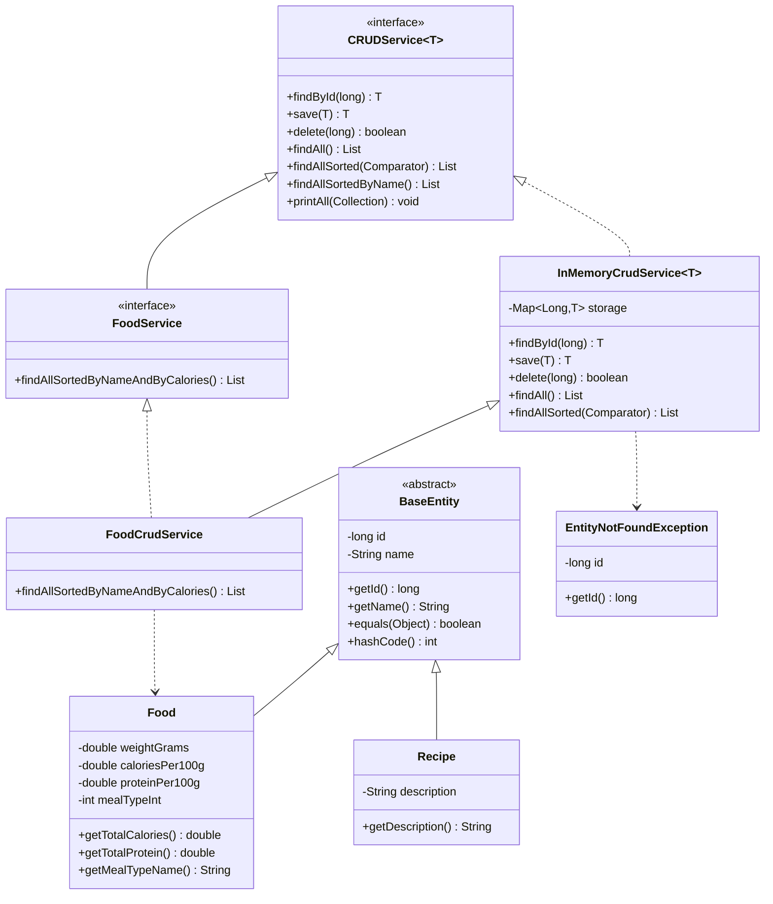

---

# Лабораторна робота №7–9. Реалізація типізованого CRUD-сервісу

## Мета роботи

Спроєктувати та реалізувати типізований CRUD-сервіс із використанням узагальнень (Generics), колекцій Java та механізмів сортування об'єктів через `Comparator`. Навчитися створювати універсальні сервіси для роботи з різними сутностями, обґрунтовувати вибір колекцій та використовувати wildcard.

## Предметна область

Тема проєкту — **«Облік спожитих калорій»**.

Для лабораторної роботи використовується окрема реалізація сутностей `Food` і `Recipe`. Обидві сутності успадковують абстрактний клас `BaseEntity`, який містить спільні поля `id` та `name`.

Програма дозволяє:
- додавати та оновлювати записи;
- знаходити сутності за ідентифікатором;
- видаляти записи;
- сортувати страви за назвою та калорійністю;
- працювати з різними типами сутностей через один узагальнений сервіс.

## Структура класів

### 1. `BaseEntity` — базовий абстрактний клас

Містить спільні характеристики сутностей:
- `id` — унікальний ідентифікатор;
- `name` — назва сутності.

Поле `id` оголошене як `final`, тому його значення не можна змінити після створення об'єкта.

Також реалізовано:
- гетери;
- `equals()` — порівняння сутностей за ID;
- `hashCode()` — обчислення хеш-коду за ID;
- `toString()` — текстове представлення об'єкта.

### 2. `Food` — сутність страви

Успадковує `BaseEntity` та містить додаткові поля:
- `weightGrams` — вага страви;
- `caloriesPer100g` — калорійність на 100 грамів;
- `proteinPer100g` — кількість білків на 100 грамів;
- `mealTypeInt` — тип прийому їжі.

Реалізовано методи:
- `getTotalCalories()` — обчислення загальної калорійності;
- `getTotalProtein()` — обчислення загальної кількості білків;
- `getMealTypeName()` — отримання назви типу прийому їжі.

### 3. `Recipe` — сутність рецепта

Успадковує `BaseEntity` та містить поле `description`, яке зберігає опис рецепта.

Ця сутність використовується для демонстрації роботи універсального CRUD-сервісу з іншим типом об'єктів.

### 4. `CRUDService<T extends BaseEntity>` — узагальнений інтерфейс

Визначає загальний контракт для роботи із сутностями.

Основні методи:
- `findById(long id)` — пошук за ID;
- `save(T entity)` — додавання або оновлення;
- `delete(long id)` — видалення;
- `findAll()` — отримання всіх записів;
- `findAllSorted(Comparator<? super T> comparator)` — отримання відсортованого списку.

Метод `findAllSortedByName()` реалізований як `default`-метод інтерфейсу. Він використовує компаратор для сортування сутностей за назвою.

Статичний метод `printAll(Collection<? extends BaseEntity> items)` дозволяє виводити колекції різних типів сутностей.

Обмеження `T extends BaseEntity` гарантує, що кожна сутність має спільні поля та методи базового класу, зокрема `getId()` і `getName()`.

### 5. `InMemoryCrudService<T extends BaseEntity>` — універсальний CRUD-сервіс

Реалізує інтерфейс `CRUDService` та забезпечує зберігання сутностей у колекції `LinkedHashMap`.

Основні операції:

- `findById()` — знаходить об'єкт за ідентифікатором;
- `save()` — додає новий об'єкт або оновлює наявний;
- `delete()` — видаляє запис;
- `findAll()` — повертає список усіх записів;
- `findAllSorted()` — створює копію даних і сортує її, не змінюючи основне сховище.

Завдяки Generics цей клас можна використовувати для різних сутностей без зміни його реалізації.

### 6. `FoodService` — інтерфейс роботи зі стравами

Розширює `CRUDService<Food>` та додає спеціалізований метод:

`findAllSortedByNameAndByCalories()`.

Він сортує страви спочатку за назвою, а якщо назви однакові — за загальною калорійністю.

Метод винесений в окремий інтерфейс, оскільки калорійність є характеристикою конкретної сутності `Food`, а не всіх можливих сутностей.

### 7. `FoodCrudService` — сервіс роботи зі стравами

Успадковує `InMemoryCrudService<Food>` та реалізує `FoodService`.

Для сортування використовується:

- `Comparator.comparing()` — сортування за назвою;
- `thenComparingDouble()` — вторинне сортування за калорійністю.

Таким чином, реалізовано два критерії сортування без необхідності змінювати базовий CRUD-сервіс.

### 8. `EntityNotFoundException` — власний виняток

Успадковує `RuntimeException` та містить поле `id`.

Використовується в методі `findById()`, якщо сутність із вказаним ідентифікатором відсутня.

Обрано неперевірений виняток, оскільки відсутність запису є ситуацією, яку викликаючий код може обробити за потреби. Це не вимагає обов'язкового оголошення винятку в сигнатурі кожного методу.

## Використані колекції

Для зберігання даних використовується `LinkedHashMap<Long, T>`.

Ключем є ідентифікатор сутності, а значенням — сам об'єкт.

| Колекція | Пошук за ID | Додавання / оновлення | Видалення | Особливості |
|---|---|---|---|---|
| ArrayList | O(n) | O(1) для додавання в кінець, O(n) для пошуку й оновлення за ID | O(n) | Зберігає порядок додавання |
| HashMap | O(1) у середньому | O(1) у середньому | O(1) у середньому | Не гарантує порядок обходу |
| LinkedHashMap | O(1) у середньому | O(1) у середньому | O(1) у середньому | Зберігає порядок додавання |
| TreeMap | O(log n) | O(log n) | O(log n) | Сортує ключі |

Складність отримання відсортованого списку для кожного з цих варіантів при копіюванні елементів у список і сортуванні становить O(n log n).

**Обґрунтування вибору LinkedHashMap:**

- забезпечує швидкий пошук за ID;
- дозволяє оновлювати запис за допомогою `put()`;
- не допускає дублювання ключів;
- зберігає порядок додавання записів;
- зручно використовується для реалізації CRUD-операцій.

Метод `put()` додає новий запис або замінює значення за наявним ключем. Тому кількість записів не збільшується під час оновлення.

## Сортування об'єктів

Для сортування використовується `Comparator`, а не `Comparable`.

`Comparable` задає природний порядок безпосередньо всередині класу сутності. `Comparator` дозволяє задавати різні способи сортування незалежно від самої сутності.

У цій роботі потрібно сортувати страви за різними критеріями, тому використання `Comparator` є зручнішим.

Основний компаратор:

```java
Comparator<Food> comparator =
        Comparator.comparing(
                Food::getName,
                String.CASE_INSENSITIVE_ORDER
        ).thenComparingDouble(Food::getTotalCalories);
```

Спочатку порівнюються назви страв без урахування регістру. Якщо назви однакові, порівнюється загальна калорійність.

## Generics та Wildcard

У роботі використано узагальнення Java.

`T extends BaseEntity` обмежує тип сутності базовим класом. Завдяки цьому універсальний сервіс може використовувати методи `getId()` та `getName()`.

`Comparator<? super T>` дозволяє передавати компаратор для самого типу `T` або для одного з його батьківських типів. Це робить метод сортування гнучкішим.

`Collection<? extends BaseEntity>` дозволяє передавати колекції різних нащадків `BaseEntity`, наприклад `List<Food>` та `List<Recipe>`.

Звичайний `List<Food>` не можна передати замість `List<BaseEntity>`, оскільки узагальнені типи Java є інваріантними. Використання wildcard `? extends BaseEntity` дозволяє приймати такі колекції безпечним способом для читання.

## Узгодженість equals() і hashCode()

У `BaseEntity` методи `equals()` і `hashCode()` реалізовані на основі ID.

Компаратор сортування використовує назву та калорійність, тому він не є узгодженим з `equals()`: дві сутності з однаковим ID можуть мати різні назви або калорійність, але вважатися рівними за `equals()`.

Цей компаратор використовується для сортування списку, а не для визначення унікальності сутностей.

Для коректної роботи моделі приймається, що ID є глобально унікальними між типами сутностей.

## UML-діаграма



## Демонстрація роботи програми

У класі `Lab7Main` продемонстровано основні можливості сервісу:

1. Створення чотирьох тестових страв.
2. Додавання записів до сховища.
3. Виведення всіх записів.
4. Оновлення страви з ID 1.
5. Перевірка, що кількість записів після оновлення не збільшується.
6. Пошук страви за ID.
7. Обробка `EntityNotFoundException` під час пошуку відсутнього ID.
8. Успішне видалення запису.
9. Неуспішне видалення неіснуючого запису.
10. Сортування страв за назвою.
11. Сортування страв за назвою та калорійністю.
12. Перевірка, що сортування не змінює основне сховище.
13. Робота з другою сутністю `Recipe` через той самий узагальнений CRUD-сервіс.
14. Перевірка `equals()` та `hashCode()`.

## Результат запуску

Під час запуску програми успішно виконано всі продемонстровані операції.

Результат завершення:

```text
===== PROGRAM FINISHED =====

Process finished with exit code 0
```

Код завершення `0` свідчить про успішне завершення програми без помилок виконання.

## Інструкція запуску

Для запуску потрібен JDK 25 або сумісна версія Java.

У IntelliJ IDEA:

1. Відкрити проєкт `Calorietracker`.
2. Переконатися, що вихідні файли розташовані в `src/lab7`.
3. Переконатися, що для проєкту налаштований відповідний JDK.
4. Відкрити `Lab7Main.java`.
5. Запустити метод `main()` через зелену стрілку або конфігурацію запуску `lab7.Lab7Main`.

## Висновок

Під час виконання лабораторної роботи було реалізовано узагальнений CRUD-сервіс для керування різними типами сутностей предметної області «Облік спожитих калорій».

Було використано Generics, абстрактний базовий клас, інтерфейси, колекцію `LinkedHashMap`, механізми сортування `Comparator`, wildcard та власний виняток.

Реалізовано додавання, оновлення, пошук і видалення записів, сортування за кількома критеріями та повторне використання універсального сервісу для різних сутностей.

У результаті закріплено навички проєктування типізованих сервісів, використання колекцій Java та застосування принципів об'єктно-орієнтованого програмування.
