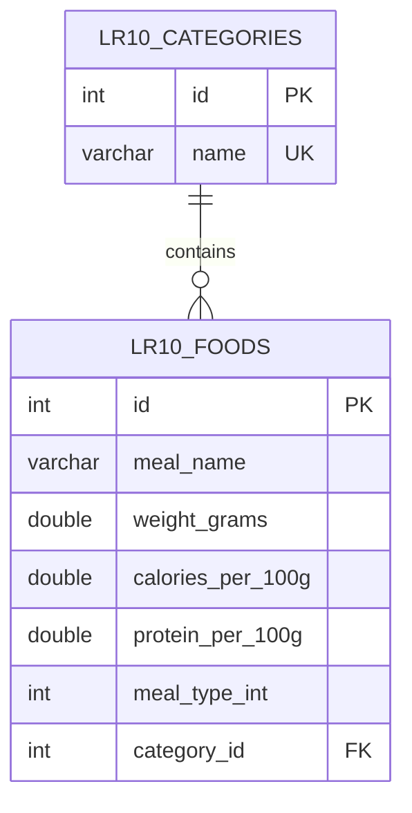

## Лабораторна робота №10. Maven як інструмент побудови проєкту. Робота з реляційною БД через JDBC

### Мета роботи

Навчитися використовувати Maven для автоматизації збирання Java-проєкту, підключати реляційну базу даних MySQL через JDBC, реалізовувати CRUD-операції, працювати з транзакціями та забезпечувати безпечне виконання SQL-запитів.

### Предметна область

**Облік спожитих калорій.**

У лабораторній роботі №10 реалізовано зберігання інформації про страви та категорії прийомів їжі в базі даних MySQL замість зберігання об'єктів у пам'яті програми.

### Використані технології

- Java 17
- Apache Maven
- JDBC
- MySQL
- MySQL Connector/J
- HikariCP
- PreparedStatement
- Git та GitHub
- IntelliJ IDEA

### Структура проєкту

Основний код розміщений у пакеті `com.calorietracker.lr10`.

- `Main.java` — демонстрація функціональності програми.
- `database/DBConnection.java` — підключення до MySQL через HikariCP.
- `database/DatabaseInitializer.java` — автоматична ініціалізація бази даних.
- `model/BaseEntity.java` — базовий клас сутностей.
- `model/Food.java` — модель страви.
- `model/Category.java` — модель категорії.
- `service/AbstractJdbcCrudService.java` — узагальнений JDBC CRUD-сервіс.
- `service/JdbcFoodService.java` — операції зі стравами.
- `service/JdbcCategoryService.java` — операції з категоріями.
- `service/FoodTransactionService.java` — робота з транзакціями.
- `service/BatchBenchmark.java` — порівняння швидкості вставки записів.
- `service/SqlInjectionDemo.java` — демонстрація захисту від SQL-ін'єкцій.
- `service/EntityNotFoundException.java` — обробка ситуації, коли сутність не знайдено.

### Структура бази даних

У базі даних `polysource` використовуються дві таблиці:

**Таблиця `lr10_categories`:**

- `id` — первинний ключ.
- `name` — унікальна назва категорії.

**Таблиця `lr10_foods`:**

- `id` — первинний ключ.
- `meal_name` — назва страви.
- `weight_grams` — вага порції.
- `calories_per_100g` — калорійність на 100 грамів.
- `protein_per_100g` — кількість білків на 100 грамів.
- `meal_type_int` — тип прийому їжі.
- `category_id` — зовнішній ключ категорії.

### ER-діаграма



Одна категорія може містити багато страв. Кожна страва належить одній категорії. Зв'язок реалізовано через зовнішній ключ `category_id`.

### Реалізований функціонал

**1. CRUD-операції**

Реалізовано створення, читання, оновлення та видалення записів у базі даних.

**2. Сортування та пагінація**

Передбачено сортування записів за назвою та отримання обмеженої кількості записів за допомогою `LIMIT` і `OFFSET`.

**3. Узагальнений JDBC-сервіс**

Реалізовано `AbstractJdbcCrudService<T>`, який дозволяє повторно використовувати загальну логіку CRUD для різних сутностей.

**4. Транзакції**

Реалізовано транзакції з використанням `commit()` і `rollback()`.

У разі успішного виконання обидві зміни зберігаються. Якщо виникає помилка, транзакція скасовується, а дані залишаються в попередньому стані.

**5. Batch Insert**

Реалізовано пакетне додавання записів через `addBatch()` та `executeBatch()`.

**6. Захист від SQL Injection**

Для безпечної передачі параметрів SQL-запитів використовується `PreparedStatement`.

**7. Пул підключень**

Для керування JDBC-з'єднаннями використовується HikariCP. Доступ до пулу організовано через клас `DBConnection`.

### Результати порівняння швидкості

Під час одного з тестових запусків було виконано вставку 100 записів двома способами.

| Спосіб | Кількість записів | Час |
|---|---:|---:|
| Звичайна вставка | 100 | 525,38 мс |
| Batch Insert | 100 | 71,13 мс |

**Результат:** у цьому запуску пакетна вставка виконалася приблизно у 7,39 раза швидше.

Показники можуть відрізнятися залежно від навантаження на систему та параметрів MySQL.

### Інструкція запуску

1. Перейдіть до гілки лабораторної роботи:

   `git checkout lr10/maven-jdbc`

2. Переконайтеся, що встановлено JDK 17 або новішу версію, сумісну з налаштуваннями Maven, та доступний сервер MySQL.

3. Створіть базу даних `polysource`, якщо вона ще не існує, і налаштуйте користувача MySQL з необхідними правами.

4. У файлі `src/main/resources/application.properties` задайте основні параметри JDBC. Справжній пароль зберігайте в локальному файлі `application-local.properties` у корені проєкту:

   ```properties
   db.username=YOUR_MYSQL_USERNAME
   db.password=YOUR_MYSQL_PASSWORD
   ```

   Локальний файл із паролем не додається до Git.

5. Імпортуйте проєкт Maven в IntelliJ IDEA.

6. Виконайте команду:

   `mvn compile`

7. Запустіть клас:

   `com.calorietracker.lr10.Main`

Під час запуску програма автоматично виконує SQL-скрипт `init.sql`, створює необхідні таблиці, якщо вони відсутні, та демонструє основні можливості лабораторної роботи.

### Результати виконання

Успішно перевірено:

- Створення, читання, оновлення та видалення страв.
- Отримання списку категорій.
- Сортування і пагінацію.
- Успішне виконання `COMMIT`.
- Скасування змін через `ROLLBACK`.
- Пакетну вставку 100 записів.
- Захист параметризованих запитів від SQL Injection.
- Видалення тестових записів після демонстрацій.

Програма завершила роботу з кодом `0`.

### GitHub

Лабораторна робота №10 виконується в окремій гілці:

`lr10/maven-jdbc`

Попередні лабораторні роботи зберігаються у своїх гілках і не змінюються.