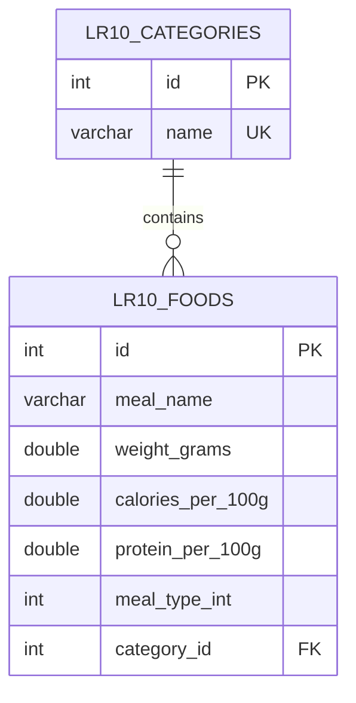

---

## Лабораторна робота №11. Hibernate ORM та Jakarta Persistence

### Мета роботи

Навчитися використовувати Hibernate ORM для роботи з реляційною базою даних MySQL, застосовувати Jakarta Persistence API, реалізовувати CRUD-операції через `EntityManager`, налаштовувати зв'язки між сутностями та виконувати запити JPQL.

Дослідити особливості лінивого завантаження (`LAZY`), проблему N+1 та її вирішення за допомогою `JOIN FETCH`.

### Предметна область

**Облік спожитих калорій.**

У лабораторній роботі №11 продовжено розробку застосунку для обліку спожитих калорій. Замість ручного виконання SQL-запитів через JDBC використовується Hibernate ORM.

Збережено предметну область попередніх лабораторних: страви (`Food`) та категорії прийомів їжі (`Category`).

### Використані технології

- Java 17
- Apache Maven
- Hibernate ORM 6.6.42.Final
- Jakarta Persistence API 3.1
- MySQL
- MySQL Connector/J
- JPQL
- SLF4J
- Git та GitHub
- IntelliJ IDEA

### Структура проєкту

Код лабораторної роботи розміщено в пакеті `com.calorietracker.lr11`.

- `Main.java` — демонстрація можливостей Hibernate ORM.
- `config/JpaUtil.java` — створення `EntityManagerFactory`, робота з `EntityManager` і транзакціями.
- `model/BaseEntity.java` — базовий клас сутностей з анотацією `@MappedSuperclass`.
- `model/Food.java` — JPA-сутність страви.
- `model/Category.java` — JPA-сутність категорії.
- `service/CRUDService.java` — узагальнений CRUD-інтерфейс.
- `service/FoodService.java` — інтерфейс операцій зі стравами.
- `service/HibernateFoodService.java` — реалізація CRUD через Hibernate.
- `service/HibernateCategoryService.java` — робота з категоріями.
- `exception/EntityNotFoundException.java` — власний виняток для відсутніх сутностей.
- `META-INF/persistence.xml` — конфігурація Jakarta Persistence.
- `init.sql` — SQL-скрипт створення таблиць.

### Налаштування Hibernate

У файлі `persistence.xml` визначено persistence unit `calorieTrackerPU` та підключено JPA-сутності `Food` і `Category`.

Основні параметри:

- `hibernate.hbm2ddl.auto=validate` — перевірка відповідності структури бази даних JPA-сутностям.
- `hibernate.show_sql=true` — виведення SQL-запитів.
- `hibernate.format_sql=true` — форматування SQL.
- `hibernate.generate_statistics=true` — збирання статистики Hibernate.

Режим `validate` не створює і не змінює таблиці автоматично.

### JPA-сутності та зв'язки

У проєкті реалізовано дві сутності:

**Food** — страва, яка містить назву, вагу, калорійність, кількість білків, тип прийому їжі та категорію.

**Category** — категорія прийому їжі, яка містить назву та колекцію страв.

Зв'язок між сутностями:

- `@ManyToOne(fetch = FetchType.LAZY)` — багато страв належать одній категорії.
- `@OneToMany(mappedBy = "category", fetch = FetchType.LAZY)` — одна категорія містить багато страв.
- `@JoinColumn(name = "category_id")` — зовнішній ключ у таблиці страв.

Для базового класу використано `@MappedSuperclass`, що дозволяє успадковувати спільні поля `id` і `name`.

### ER-діаграма

### Реалізований функціонал

**1. CRUD-операції**

Через Hibernate реалізовано:

- Створення страв.
- Пошук страви за ID.
- Оновлення даних страви.
- Отримання списку страв.
- Видалення страв.

Для операцій використовується `EntityManager`. Зміни даних виконуються в транзакціях.

**2. Робота через інтерфейси**

Клас `HibernateFoodService` реалізує `FoodService`, який розширює узагальнений `CRUDService<Food>`.

Це дозволяє відокремити інтерфейс роботи з даними від конкретної технології збереження.

**3. JPQL-запити**

Реалізовано сортування за назвою, сортування за калорійністю, комбіноване сортування та фільтрацію страв за категорією.

**4. Пагінація**

Для отримання частини результатів використовуються:

- `setFirstResult()` — початкова позиція.
- `setMaxResults()` — максимальна кількість записів.

**5. Lazy Loading**

Зв'язки між сутностями налаштовано з використанням `FetchType.LAZY`.

Продемонстровано виникнення `LazyInitializationException` під час звернення до незавантаженої колекції після закриття `EntityManager`.

**6. Проблема N+1**

Порівняно звичайне ліниве завантаження категорій і завантаження за допомогою `JOIN FETCH`.

`JOIN FETCH` дозволяє отримати страви разом із категоріями одним SQL-запитом.

**7. Обробка винятків**

Реалізовано `EntityNotFoundException`, який виникає при зверненні до неіснуючої сутності.

### Результати виконання

Під час тестового запуску успішно виконано:

- CREATE, READ, UPDATE, DELETE.
- Сортування та фільтрацію.
- Пагінацію.
- Пошук неіснуючої сутності з обробкою винятку.
- Завантаження страв через зв'язок із категорією.
- Демонстрацію `LazyInitializationException`.
- Порівняння кількості SQL-запитів.

Результат порівняння:

| Спосіб завантаження | Кількість SQL-запитів |
|---|---:|
| LAZY без JOIN FETCH | 3 |
| JOIN FETCH | 1 |

У тесті використовувалися три страви, які належали двом категоріям. Завдяки `JOIN FETCH` кількість SQL-запитів зменшилася з трьох до одного.

Після завершення демонстрації тестові страви видалено.

Maven завершив виконання з результатом `BUILD SUCCESS`.

### Інструкція запуску

1. Перейти до гілки `lr11/hibernate-orm`.
2. Переконатися, що встановлено JDK 17 або сумісну новішу версію.
3. Запустити сервер MySQL.
4. Підготувати базу даних `polysource` і таблиці відповідно до `init.sql`.
5. Налаштувати параметри підключення до MySQL у локальному файлі `application-local.properties`, не додаючи пароль до Git.
6. Відкрити Maven-проєкт в IntelliJ IDEA.
7. Виконати `mvn clean compile exec:java`.

### Висновок

У лабораторній роботі №11 реалізовано роботу з реляційною базою даних через Hibernate ORM та Jakarta Persistence.

Закріплено навички створення JPA-сутностей, використання `EntityManager`, виконання CRUD-операцій, написання JPQL-запитів, налаштування зв'язків і аналізу продуктивності завантаження даних.

### GitHub

Лабораторна робота №11 виконується в окремій гілці:

`lr11/hibernate-orm`

Код попередніх лабораторних робіт залишається у відповідних гілках.