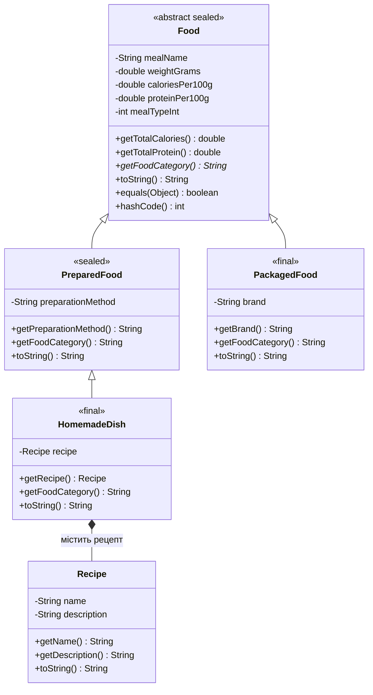

---

# Лабораторна робота №6. Наслідування та поліморфізм у Java

## Мета роботи

Закріпити принципи об'єктно-орієнтованого програмування мовою Java: наслідування, поліморфізм, абстракцію та композицію. Навчитися створювати ієрархію класів, перевизначати методи, використовувати абстрактні й запечатані класи (`abstract`, `sealed`), модифікатор `final`, а також реалізовувати методи `equals()` і `hashCode()`.

## Предметна область

Тема проєкту — **«Облік спожитих калорій»**.

Програма дозволяє створювати різні типи продуктів і страв, зберігати їх у масиві базового типу `Food`, обчислювати загальну калорійність та кількість білків, сортувати продукти за калорійністю, шукати страви за назвою та перевіряти рівність об'єктів.

## Реалізована ієрархія класів

### 1. `Food` — базовий абстрактний клас

Клас `Food` описує загальні характеристики продукту або страви:

- `mealName` — назва;
- `weightGrams` — вага порції в грамах;
- `caloriesPer100g` — калорійність на 100 г;
- `proteinPer100g` — вміст білків на 100 г;
- `mealTypeInt` — тип прийому їжі.

Клас оголошений як `abstract sealed`. Він містить абстрактний метод `getFoodCategory()`, методи обчислення загальної калорійності й білків, а також реалізації `toString()`, `equals()` і `hashCode()`.

Методи `getTotalCalories()` та `getTotalProtein()` оголошені як `final`, оскільки їхня логіка не повинна змінюватися в дочірніх класах.

### 2. `PreparedFood` — приготована страва

Клас успадковує `Food` і додає поле `preparationMethod`, яке визначає спосіб приготування.

Для передавання параметрів базовому класу використовується `super()`. Перевантажений конструктор викликає інший конструктор цього ж класу за допомогою `this()`.

### 3. `HomemadeDish` — домашня страва

Клас успадковує `PreparedFood` і додає рецепт, представлений окремим об'єктом класу `Recipe`.

Клас оголошений як `final`, тому від нього не можна успадковувати інші класи.

### 4. `PackagedFood` — фасований продукт

Клас успадковує `Food` і містить додаткове поле `brand`, яке зберігає назву виробника. Він також оголошений як `final`.

### 5. `Recipe` — рецепт страви

Клас містить назву рецепта (`name`) та його опис (`description`). Об'єкт `Recipe` використовується в `HomemadeDish`, демонструючи композицію: домашня страва має рецепт.

## Діаграма класів



## Реалізовані принципи ООП

### Наслідування

`PreparedFood` і `PackagedFood` успадковують спільні характеристики та методи класу `Food`. `HomemadeDish` успадковує `PreparedFood`, утворюючи трирівневу ієрархію.

### Поліморфізм

Масив `Food[]` зберігає об'єкти різних дочірніх класів. Під час виклику `toString()` і `getFoodCategory()` Java виконує відповідні перевизначені методи фактичного типу об'єкта.

### Абстракція

Абстрактний клас `Food` визначає спільну структуру продуктів, а метод `getFoodCategory()` змушує дочірні класи реалізувати власну категорію.

### Композиція

`HomemadeDish` містить поле типу `Recipe`. Завдяки цьому інформація про рецепт зберігається в окремому об'єкті, а не лише у вигляді рядка.

### `sealed`, `permits` і `final`

- `Food permits PreparedFood, PackagedFood` обмежує перелік безпосередніх дочірніх класів.
- `PreparedFood permits HomemadeDish` визначає дозволений дочірній клас.
- `HomemadeDish` і `PackagedFood` мають модифікатор `final`, що забороняє подальше наслідування.

### `equals()` і `hashCode()`

Метод `equals()` порівнює об'єкти за значеннями їхніх полів. Метод `hashCode()` обчислює хеш-код на основі тих самих характеристик, які використовуються під час перевірки рівності.

У базовому класі застосовується `getClass()` для перевірки фактичного типу об'єктів. Це не дозволяє вважати об'єкти різних класів рівними лише через однакові спільні поля.

## Функціональні можливості програми

1. Введення інформації про продукти з клавіатури.
2. Створення приготованих страв, фасованих продуктів і домашніх страв.
3. Збереження об'єктів у масиві `Food[]`.
4. Виведення характеристик продуктів.
5. Сортування за загальною калорійністю методом Bubble Sort.
6. Підрахунок кількості продуктів із калорійністю понад 400 ккал.
7. Пошук продукту за назвою.
8. Перевірка типів об'єктів через `instanceof` із pattern matching.
9. Обробка типів об'єктів через `switch` із pattern matching.
10. Перевірка `equals()` і `hashCode()`, зокрема симетрії порівняння та порівняння домашніх страв із різними рецептами.

## Інструкція запуску

Для запуску потрібен JDK, який підтримує `sealed`-класи та pattern matching для `switch` (наприклад, JDK 21 або новіший).

У IntelliJ IDEA:

1. Відкрити проєкт `Calorietracker`.
2. Переконатися, що файли `Food.java`, `PreparedFood.java`, `PackagedFood.java`, `HomemadeDish.java`, `Recipe.java` і `Main.java` знаходяться у відповідному пакеті.
3. Вибрати потрібну версію JDK у налаштуваннях проєкту.
4. Відкрити `Main.java`.
5. Натиснути **Run**.

Якщо всі файли знаходяться в одному пакеті, проєкт можна скомпілювати з каталогу, у якому розташовані вихідні файли:

```bash
javac *.java
java Main
```

Якщо проєкт має структуру `src` і файли не містять оголошення пакета:

```bash
javac -d out src/*.java
java -cp out Main
```

Якщо в коді використовується оголошення `package`, команди запуску потрібно адаптувати до назви пакета та структури каталогів.

## Висновок

Під час виконання лабораторної роботи було розширено консольний застосунок обліку калорій за допомогою принципів об'єктно-орієнтованого програмування. Створено ієрархію класів для різних типів продуктів, реалізовано наслідування, поліморфізм, абстракцію та композицію. Також використано sealed-класи, final, pattern matching, перевизначення методів toString(), equals() і hashCode() та перевірки рівності об'єктів.